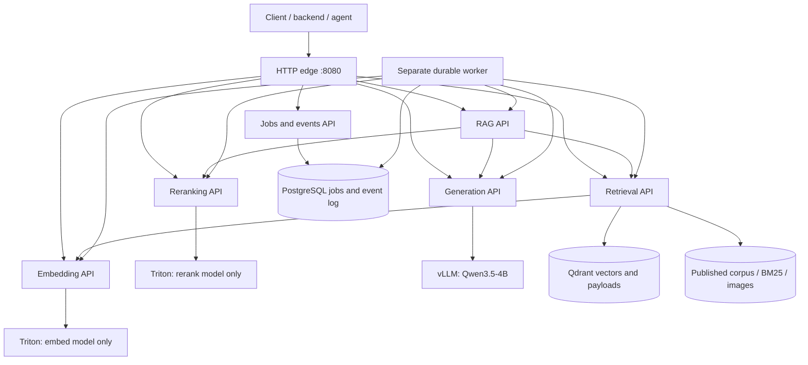

# API-first multimodal RAG deployment

This directory is the deployment entry point on branch `deployment/triton-vllm-microservices`. The notebook and standalone applications outside it remain the research implementation. This branch does not replace or merge into `main`.

**Status:** implementation and CPU contract tests are supplied; Docker builds, CUDA/model execution, PostgreSQL/Qdrant integration, and GPU capacity must be verified on your machine. Start with the live smoke test below. Do not interpret the old PDF's timings as measurements of this deployment.

## Which pipeline is final?

The default is **direct Qwen3-VL embedding + vocabulary-gated BM25 + RRF + Qwen3-VL text reranking**, followed by Qwen3.5-4B when an answer is requested. Agent mode is an explicit option, not a universally better replacement.

| Recorded research configuration | Mean Recall@1 | Mean Recall@10 | Retrieval/planning/reranking latency |
|---|---:|---:|---:|
| Final direct, text rerank | 0.748 | 0.884 | 0.971 s |
| Final with agent, text rerank | 0.668 | 0.900 | 5.637 s |

Source: [`results/summary.md`](../results/summary.md), [`scripts/make_report.py`](../scripts/make_report.py), and [`scripts/eval_final.py`](../scripts/eval_final.py). The earlier agent improved a weaker Nemotron pipeline; that is not evidence that it beats the final Qwen pipeline on top-1 retrieval. These synthetic known-item experiments used small subsets. Answer generation was excluded from those latency measurements. A small top-10 difference is not proof of a general advantage or statistical significance.

This deployment changes serving engines, process boundaries, numerical execution, and index storage. Run its paired evaluation before claiming equivalent or better quality. It preserves the main branch's model revisions, gated fusion, original-query retention in agent mode, and text-rerank default. It is not a bit-for-bit replay of the research harness.

## Architecture and ownership



Each API is a separate process/container with its own lifecycle. Each model has its own serving container; calling reranking does not initialize embedding or generation. The shared Python package supplies contracts and adapters, not an in-process monolith. Retrieval owns corpus publication and index state; jobs owns durable work state. RAG owns no database and loads no models.

Triton here means **NVIDIA Triton Inference Server with Python backends**, not the Triton GPU-kernel language. Its backends call the revision-pinned SentenceTransformers embedding and CrossEncoder interfaces. This is not a TensorRT conversion and does not itself establish a speedup. Triton handles model lifecycle and bounded dynamic batches; vLLM serves autoregressive generation through its own scheduler. Generation is kept outside Triton rather than adding a second serving layer around vLLM.

## Public APIs

All capability routes require `X-API-Key`. Corpus mutations additionally require `X-Admin-Key`. Index creation/publication are synchronous administrative APIs; ingestion also supports durable jobs/events.

| API | Purpose |
|---|---|
| `POST /v1/embeddings` | Query or document embeddings; text, image, or both; batch up to 32 |
| `POST /v1/rerank` | Rank supplied documents independently of the recipe corpus; text/image queries and documents |
| `POST /v1/chat/completions` | Bounded, nonstreaming OpenAI-style generation subset |
| `POST /v1/search` | Dense semantic, lexical-only, or gated hybrid search; no reranking or answer generation |
| `GET/POST /v1/indexes` | List/create immutable, versioned corpus indexes |
| `GET /v1/indexes/{id}` | Publication status and embedding/source manifest |
| `GET /v1/indexes/{id}/documents` | Paginated metadata catalog, including evaluation ordinals |
| `PUT /v1/indexes/{id}/documents` | Idempotent immutable-document ingestion |
| `POST /v1/indexes/{id}/publish` | Publish only after the exact expected document count is present |
| `POST /v1/rag` | Full pipeline; `strategy: direct` or `agent`; answer and image rerank optional |
| `POST /v1/jobs` | Durable typed operation, requiring `Idempotency-Key` |
| `POST /v1/events` | Event submission with caller-supplied stable event ID |
| `GET /v1/jobs/{id}` | Durable status, result, attempts, and error |
| `GET /v1/jobs/{id}/events` | Ordered, paginated lifecycle events |
| `GET /v1/jobs/{id}/events/stream` | Resumable lifecycle SSE using `Last-Event-ID` |

For each role (`embeddings`, `reranking`, `generation`, `retrieval`, `rag`, `jobs`), discover `/services/{role}/openapi.json`, `/services/{role}/docs`, `/services/{role}/healthz`, `/services/{role}/readyz`, and `/services/{role}/v1/info`. OpenAPI schema pages contain no credentials or model results. Use an authenticated HTTP client for actual operations. The edge's `/healthz` only says the proxy is alive; `/readyz` checks full RAG dependencies.

Generation supports text/image messages, bounded sampling, and a single planning response with tool calls. It deliberately rejects `stream: true`, arbitrary provider fields, and tool-result conversations. Job SSE is **durable lifecycle progress**, not fake token streaming and not a record of every internal RAG stage. The application never executes arbitrary model-proposed tools.

## Machine requirements and first run

Use a Linux NVIDIA GPU host, Docker Engine with Compose v2, and NVIDIA Container Toolkit. The BF16 model path targets Ampere or newer GPUs. The supplied Triton image uses Python 3.12; the host tooling can run in its own Python 3.12 virtual environment. GPU drivers must actually run the selected container CUDA runtimes: the doctor command executes CUDA probes rather than assuming that `nvidia-smi` alone proves compatibility. Allow disk space for container layers, all model weights, dataset images, and persistent indexes; inspect `doctor.json` before the corpus import.

```bash
git clone --branch deployment/triton-vllm-microservices \
  git@github.com:ehzawad/multimodal-rag-nemotron.git
cd multimodal-rag-nemotron/deployment
python3.12 -m venv .venv
source .venv/bin/activate
python -m pip install -r requirements-tools.txt
python manage.py init-env
bash verify-machine.sh
```

`init-env` refuses to overwrite an existing `.env`, generates distinct random application/admin/database secrets, and records the checkout commit. Never commit that file. The verification script checks the host, builds images, pulls pinned server images, probes CUDA and vLLM CLI flags, records image identities, starts the services, then runs actual model/API smoke checks. It can take substantial time on first startup. An error is a failed check, not evidence that the deployment was validated. Inspect `docker compose ps` and `docker compose logs --tail=150 SERVICE` before retrying.

The smoke test creates only three synthetic recipe-card fixtures. It checks actual embedding dimensions/norms, image inputs, text/image reranking, direct generation, direct and agent RAG, image-only query rewriting, durable ingestion, event idempotency, and SSE replay. It does not measure real recipe quality or sustained production load. Agent fallback to an unplanned original query causes the live agent smoke test to fail so a broken tool parser cannot pass silently.

Only the edge binds a host port, and that binding is **127.0.0.1:8080** by default. From another computer, use a tunnel:

```bash
ssh -L 8080:127.0.0.1:8080 your-user@your-gpu-server
```

For Internet exposure, add your own TLS termination, authentication/authorization policy, firewall, and per-user quotas. Do not publish raw Triton, vLLM, Qdrant, or PostgreSQL ports. This is a trusted-application-key deployment, not an implemented multitenant identity system.

### Start just one capability

```bash
# Only reranking, its own model server, the small volume initializer, and the proxy.
docker compose up -d --build edge reranking

# Embeddings alone:
docker compose up -d --build edge embeddings

# Durable reranking events without starting the RAG/embedding/generation services:
docker compose up -d --build edge reranking jobs worker
```

The edge resolves services dynamically and does not require unavailable services to exist at startup. Readiness for a selected role is independent; full `/readyz` naturally fails when the rest of RAG is intentionally stopped. Stop unnecessary model services before a selective-capability test when GPU memory is constrained.

### The 24 GB profile is not a fit guarantee

Defaults place all three model processes on GPU 0. One instance of each Triton model, model microbatches of two, one generation sequence, eager execution, disabled prefix caching, an 8,192-token generator limit, and a vLLM memory fraction of 0.44 are conservative **unbenchmarked starting values**. The old single-process 17.7 GB measurement does not establish memory use for this topology. Resident weights, separate CUDA contexts, activations, KV/recurrent state, and runtime reservations still have to fit.

A shared same-host `flock` serializes actual model work and initialization; vLLM startup/warmup also takes that lock. This reduces overlapping peaks but does **not** free resident weights, cap another process's allocator, cancel a timed-out kernel, or provide distributed scheduling. A first attempt may still OOM on a 24 GB A5000/L4. Test model services separately first, then the complete stack. Do not increase CPU workers to solve GPU throughput.

On a machine with three GPUs, set these in `.env` before starting:

```dotenv
EMBED_GPU=0
RERANK_GPU=1
GEN_GPU=2
GPU_SERIALIZE=0
VLLM_GPU_MEMORY_UTILIZATION=0.80
```

Only disable shared-GPU serialization when models no longer contend for the same GPU or when you have measured a safe alternative. Raise `MODEL_API_CONCURRENCY`, `RAG_CONCURRENCY`, and `VLLM_MAX_NUM_SEQS` after measurement. Different hosts require your own private networking/service URLs and capacity policy; a local file lock is not a distributed GPU governor.

## Index the actual corpus

After smoke tests pass:

```bash
python manage.py seed-recipes --index recipes-v1
# Or perform the same immutable batches through the durable job API:
# python manage.py seed-recipes --index recipes-v1 --jobs
```

The importer resolves and records a concrete Hugging Face dataset revision, converts each image to a supported data URL, calls the embedding API, and publishes after all 10,096 records are present. It prints a revision you can supply with `--revision` when resuming. Retries reuse document IDs and hashes; different content under an existing ID is rejected. Ingestion is not done inside API startup, so booting a model server never silently re-embeds a corpus.

For a first partial import, use a **different** index name:

```bash
python manage.py seed-recipes --index recipes-small-v1 --limit 100
```

Do not publish a 100-document index as `recipes-v1` and then expect to append the rest: published indexes are immutable. Create a new version for changed documents/models. There is intentionally no destructive delete/reset API.

The manifest records expected counts, source, transform, query instruction, document checksum, and embedding fingerprint. Model revisions, dimension, normalization, preprocessing limits, and key numerical library versions are part of that fingerprint. Bare `.safetensors` files from an earlier experiment are not silently imported. Recipe ingestion strips reviews for embedding/reranking; the importer explicitly caps stored content at 32,000 characters and records truncation. This bound is another reason to rerun evaluation rather than assume exact research parity.

Qdrant stores vectors and metadata. The retrieval service owns immutable local corpus snapshots, content-addressed images, and its BM25 projection. Back up **both** the Qdrant volume and retrieval index volume, plus PostgreSQL for jobs. `docker compose down` preserves named volumes; `docker compose down -v` destroys them. The current writer is single-owner/single-host, not a horizontally replicated index coordinator.

## Call the capabilities

The examples below run from `deployment/`. Export the generated application key without putting its value in your shell history:

```bash
export API_KEY="$(python -c "from pathlib import Path; print(dict(l.split('=',1) for l in Path('.env').read_text().splitlines() if l and not l.startswith('#'))['API_KEY'])")"
```

Independent embedding, with an instruction suitable for generic text instead of recipes:

```bash
curl --fail-with-body http://127.0.0.1:8080/v1/embeddings \
  -H "X-API-Key: $API_KEY" -H 'Content-Type: application/json' \
  -d '{"input_type":"query","instruction":"Retrieve passages relevant to the search query.","inputs":[{"text":"GPU memory admission control"}]}'
```

Independent reranking does not need an index or the generator:

```bash
curl --fail-with-body http://127.0.0.1:8080/v1/rerank \
  -H "X-API-Key: $API_KEY" -H 'Content-Type: application/json' \
  -d '{"query":{"text":"GPU memory admission control"},"documents":[{"text":"Reject work when the GPU memory budget is exhausted."},{"text":"Bake banana bread for 45 minutes."}],"instruction":"Judge whether the passage answers the search query.","top_k":2}'
```

Semantic search is separately callable and does not generate an answer:

```bash
curl --fail-with-body http://127.0.0.1:8080/v1/search \
  -H "X-API-Key: $API_KEY" -H 'Content-Type: application/json' \
  -d '{"index_id":"recipes-v1","query":{"text":"quick spinach dinner"},"mode":"dense","top_k":5}'
```

Full RAG, with optional agent planning:

```bash
curl --fail-with-body http://127.0.0.1:8080/v1/rag \
  -H "X-API-Key: $API_KEY" -H 'Content-Type: application/json' \
  -d '{"index_id":"recipes-v1","query":{"text":"quick vegetarian dinner with spinach"},"strategy":"direct","answer":true}'
# Change strategy to "agent" explicitly to enable one bounded planning call.
```

Use `{"image":"data:image/png;base64,..."}` as the query, or combine it with `text`. Images may be PNG, JPEG, or WebP, no more than 8 MiB decoded and eight million pixels. Remote image URLs, local paths, SVG, and animations are rejected. The edge and APIs cap request bodies before JSON/image validation. Reranker scores are logits. Search responses expose rank-based RRF scores even in dense-only mode; they are not raw cosine similarities or calibrated probabilities.

For a generic corpus, create an index with `transform: "none"` and a domain-appropriate `query_instruction`, ingest supplied documents, and publish. Embedding, reranking, generation, and semantic search are reusable. The high-level RAG and agent prompts are deliberately recipe-specific in this branch; they are not claimed to be a generic domain agent.

## API-callable jobs and events

Every model/search capability can be scheduled, not just end-to-end RAG. Supported job kinds are `embed`, `rerank`, `generate`, `search`, `rag`, and `ingest`. Their payloads are the same typed API bodies; ingestion wraps `index_id` and `batch`.

```bash
curl --fail-with-body http://127.0.0.1:8080/v1/events \
  -H "X-API-Key: $API_KEY" -H 'Content-Type: application/json' \
  -d '{"id":"example-rerank-001","type":"rerank.requested","data":{"query":{"text":"spinach dinner"},"documents":[{"text":"spinach and chickpea stew"},{"text":"banana bread"}],"top_k":2}}'
```

The response includes a job `id`. Submit the same event ID and identical body to recover the same job; reuse with different content returns a conflict. Other event types are `embeddings.requested`, `generation.requested`, `search.requested`, `rag.requested`, and `documents.ingest`. Ingestion events require the administrative key.

```bash
JOB_ID=replace-with-the-returned-id
curl --fail-with-body -H "X-API-Key: $API_KEY" \
  "http://127.0.0.1:8080/v1/jobs/$JOB_ID"
curl -N --fail-with-body -H "X-API-Key: $API_KEY" -H 'Last-Event-ID: 0' \
  "http://127.0.0.1:8080/v1/jobs/$JOB_ID/events/stream"
```

There is no in-memory background-task queue. PostgreSQL transactions own acceptance and lifecycle events; a separate worker claims rows with `FOR UPDATE SKIP LOCKED`, renews leases, fences stale owners, and retries eligible failures with a bounded attempt budget. Completion and its event commit together. Event delivery/work execution is **at least once**. A worker crash may repeat a read-only model call and incur cost; immutable ingestion prevents conflicting rewrites but this is not an exactly-once GPU execution guarantee. A failed terminal job is not automatically revived by replaying its idempotency key.

## Verification and operations

CPU contract tests, without downloading any model:

```bash
python3 -m venv .test-venv
source .test-venv/bin/activate
python -m pip install -r requirements-test.txt
PYTHONPATH=. python -m pytest -q tests
```

The tests use explicit test doubles for model servers, Qdrant, and lexical indexing, and SQLite to exercise the job state machine. They do not validate PostgreSQL's real concurrent locking or CUDA. There is no deployed fake-model fallback. See [VERIFICATION.md](VERIFICATION.md) for the actual build-environment record.

After the full corpus is published, compare the two strategies on the repository's existing queries:

```bash
python manage.py eval --index recipes-v1 --n 50 --strategies direct,agent
python manage.py benchmark --index recipes-v1 --n 20 --concurrency 1
python manage.py benchmark --index recipes-v1 --strategy agent --answer --n 20 --concurrency 1
```

The evaluation verifies dataset row ordinal/title alignment before scoring. It records the query-file hash and index manifest, evaluates identical query prefixes for both strategies, and excludes answer generation. `benchmark --answer` measures HTTP end-to-end requests including generation, saves p50/p95, failures, and successful throughput, and is explicitly a closed-loop test. Neither is an answer-faithfulness evaluation or an Internet-scale load test.

Machine evidence is written under ignored `artifacts/`: `doctor.json`, `images.json`, `smoke.json`, corpus manifests, `evaluation.json`, and `benchmark.json`. Benchmark files overwrite on rerun; copy them to run-specific directories when comparing configurations. Service logs contain request IDs, status, and duration, not image bodies or API keys. Native Triton/vLLM metrics remain available on the private Docker network; a dashboard/OTel collector is not bundled.

Pinning is explicit but not overstated: direct requirements and model revisions are pinned; container base tags and transitive dependency resolution are not a complete immutable supply-chain lock. Images save `/app/installed-requirements.txt` during build, and `record-images` records image IDs/digests. Retain those artifacts and pin your tested image digests before promotion. Record the current checkout in `DEPLOYMENT_REVISION` after updating code.

API admission is bounded, with overload returning 429 and upstream failures/timeouts sanitized. Public synchronous calls do not secretly retry. RAG has a wall-clock budget; downstream generation has its own timeout. A client disconnect or expired HTTP deadline is not a guarantee that already-dispatched GPU work stopped. Durable workers renew leases independently and reject stale completion updates.

Common failure checks: inspect `triton-embed`/`triton-rerank` logs for dependency/model load errors; inspect `vllm` for unsupported flags, tool parser, context or memory allocation failures; run `doctor --containers` for driver/runtime compatibility; use a new index version for identity/source conflicts; check both Qdrant and snapshot volumes after storage failures. Do not fix an OOM by adding Uvicorn workers or silently routing images to a text-only model.

Before public production use, still supply infrastructure TLS, tenant identity/authorization as needed, per-tenant quotas, backup/restore drills, retention/deletion policy, schema migrations beyond the initial schema, secrets management, vulnerability review, and measured SLO/capacity limits. The single-host file lock and index writer are intentionally documented boundaries rather than HA claims.

## Primary implementation references

Verified against official documentation when preparing this branch:

- [vLLM Qwen3.5 serving recipe](https://docs.vllm.ai/projects/recipes/en/latest/Qwen/Qwen3.5.html) and [v0.27.0 CLI](https://docs.vllm.ai/en/v0.27.0/cli/serve/).
- [Qwen3-VL embedding model](https://huggingface.co/Qwen/Qwen3-VL-Embedding-2B) and [reranker model](https://huggingface.co/Qwen/Qwen3-VL-Reranker-2B).
- [Triton Python backend](https://github.com/triton-inference-server/python_backend), [model configuration](https://docs.nvidia.com/deeplearning/triton-inference-server/user-guide/docs/user_guide/model_configuration.html), and [26.07 release notes](https://docs.nvidia.com/deeplearning/triton-inference-server/release-notes/rel-26-07.html).
- [Docker Compose GPU reservations](https://docs.docker.com/compose/how-tos/gpu-support/) and [NVIDIA Container Toolkit](https://docs.nvidia.com/datacenter/cloud-native/container-toolkit/latest/install-guide.html).
- [Qdrant query API](https://api.qdrant.tech/api-reference/search/query-points), [PostgreSQL SELECT locking](https://www.postgresql.org/docs/18/sql-select.html), and [FastAPI lifespan](https://fastapi.tiangolo.com/advanced/events/).
